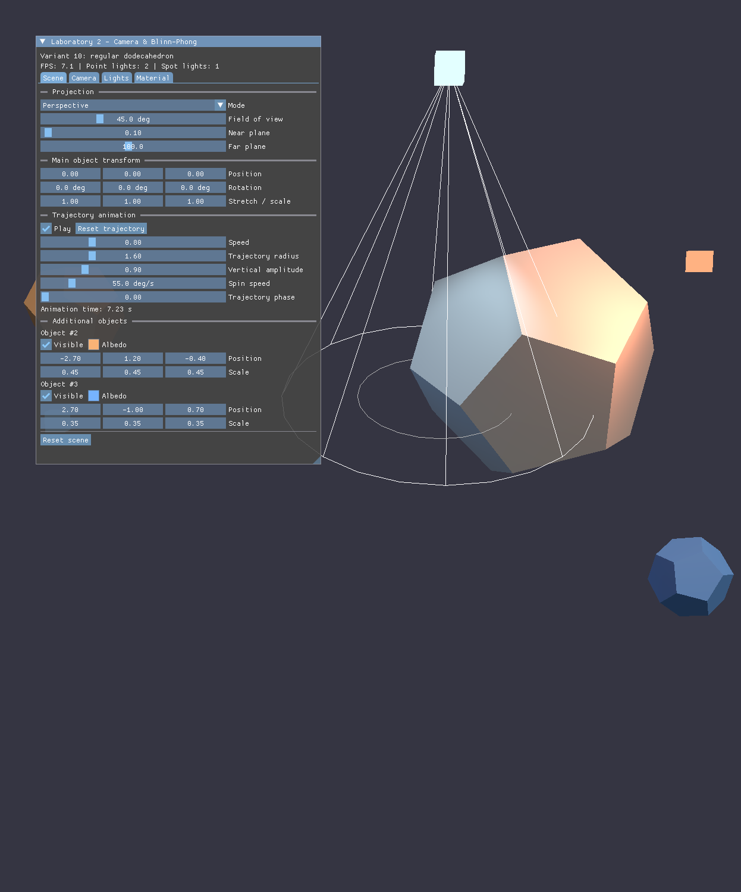

# Лабораторная работа №2. Камера, освещение и динамические источники света

## Вариант и цель работы

**Вариант 10: правильный додекаэдр.**

Цель работы — реализовать интерактивную сцену с камерой, моделью освещения
Блинна–Фонга, несколькими динамическими источниками света, раздельными
дескрипторными наборами для сцены и модели, а также визуализацией источников
света.

В работе реализованы все дополнительные задания, поэтому работа рассчитана на
оценку **5**.

## Что реализовано

- Свободная камера: положение, yaw, pitch, угол обзора, near/far, кнопки
  «Look at origin» и «Reset camera».
- Модель освещения Блинна–Фонга: ambient, directional, point и spot lights.
- Управление материалом: albedo, цвет и сила зеркального блика, shininess.
- Направленный свет и окружающий свет с настройкой цвета и интенсивности.
- Точечные источники света через storage buffer с затуханием `1 / d²`.
- Прожекторные источники света через storage buffer с мягкой границей конуса.
- Добавление и удаление источников света в пользовательском интерфейсе.
- Отображение источников света несветящимися маркерами и конусом прожектора.
- Разделение данных на набор дескрипторов сцены и набор дескрипторов модели.
- Процедурные нормали, корректная нормальная матрица при неравномерном масштабе.
- Перспективная и ортографическая проекции, анимация и несколько объектов из
  лабораторной работы №1 сохранены.

## Сборка и запуск

```bash
cmake --preset debug
cmake --build build-debug --parallel
./build-debug/vulkan-starter-app
```

Запускать приложение нужно из корня проекта, потому что шейдеры загружаются по
относительному пути `shaders/*.spv`.

## Файлы

| Файл | Назначение |
| --- | --- |
| `source/application.cpp` | Ресурсы Vulkan, дескрипторы, буферы света, пайплайны, интерфейс, отрисовка |
| `source/mesh.hpp`, `source/mesh.cpp` | Процедурный додекаэдр, плоские нормали и цвета вершин |
| `source/math.hpp` | Векторы, матрицы, `lookAt`, перспективная и ортографическая проекции |
| `shaders/shape.vert` | Мировые координаты, нормали, цвет вершины |
| `shaders/shape.frag` | Blinn–Phong для directional, point и spot lights |
| `shaders/debug.vert` | Несветящиеся линии и маркеры источников света |
| `shaders/debug.frag` | Вывод постоянного цвета без освещения |
| `CMakeLists.txt` | Сборка шейдеров `shape` и `debug` |
| `source/main.cpp` | Заголовок окна `Laboratory 2 - Blinn-Phong Lighting` |

## Раздельные дескрипторные наборы

Данные разделены на два `VkDescriptorSetLayout`:

- **set 0 — сцена**: uniform-буфер сцены и два storage-буфера источников света;
- **set 1 — модель**: uniform-буфер с моделью и материалом.

### Набор сцены

```text
set 0, binding 0 — SceneUniform (uniform buffer)
set 0, binding 1 — PointLightGpu[] (storage buffer)
set 0, binding 2 — SpotLightGpu[]  (storage buffer)
```

`SceneUniform` содержит:

```cpp
struct SceneUniform {
    alignas(16) math::Mat4 view_projection;
    alignas(16) float camera_position[4];
    alignas(16) float ambient_color[4];
    alignas(16) float directional_direction[4]; // xyz — направление, w — интенсивность
    alignas(16) float directional_color[4];     // rgb — цвет
    alignas(16) float light_counts[4];          // x — point, y — spot
};
```

Размер структуры — 144 байта, что соответствует правилам `std140`.

Точечный источник:

```cpp
struct PointLightGpu {
    alignas(16) float position[4];       // xyz — позиция, w — резерв
    alignas(16) float color_intensity[4]; // rgb — цвет, w — интенсивность
};
```

Прожектор:

```cpp
struct SpotLightGpu {
    alignas(16) float position_intensity[4]; // xyz — позиция, w — интенсивность
    alignas(16) float direction_inner_cos[4]; // xyz — направление, w — cos(inner)
    alignas(16) float color_outer_cos[4];     // rgb — цвет, w — cos(outer)
};
```

Размеры 32 и 48 байт соответственно, что соответствует `std430`.

Максимальное количество источников:

```cpp
constexpr uint32_t max_point_lights = 32;
constexpr uint32_t max_spot_lights = 16;
```

Буферы создаются с запасом на максимальное число источников. Интерфейс меняет
только количество активных элементов, а `light_counts` сообщает шейдеру,
сколько источников обходить в цикле.

### Набор модели

```text
set 1, binding 0 — ModelUniform (uniform buffer)
```

```cpp
struct ModelUniform {
    alignas(16) math::Mat4 model;
    alignas(16) float albedo[4];         // rgb — albedo, w — флаг использования цвета вершин
    alignas(16) float specular_color[4]; // rgb — цвет блика, w — сила блика
    alignas(16) float material[4];       // x — shininess
};
```

Размер — 112 байт. Для каждого из трёх объектов создаётся собственный
uniform-буфер и собственный набор дескрипторов модели. Набор сцены общий для
всех объектов.

## Камера

Камера хранит положение и углы ориентации:

```cpp
struct CameraSettings {
    math::Vec3 position;
    float yaw;
    float pitch;
    float fov_degrees;
    float near_plane;
    float far_plane;
    bool perspective;
    float ortho_scale;
};
```

Направление взгляда вычисляется как:

```cpp
return {
    cos(pitch) * sin(yaw),
    sin(pitch),
    -cos(pitch) * cos(yaw),
};
```

Матрица вида строится через `lookAt(position, position + forward, up)`.
В интерфейсе можно менять позицию, yaw, pitch, угол обзора и плоскости
отсечения, а также автоматически навести камеру на начало координат.

Для Vulkan используется отрицательная высота viewport:

```cpp
const VkViewport viewport = {
    .x = 0.0f,
    .y = float(context.swapchain_extent.height),
    .width = float(context.swapchain_extent.width),
    .height = -float(context.swapchain_extent.height),
    .minDepth = 0.0f,
    .maxDepth = 1.0f,
};
```

Это приводит ось Y экранных координат Vulkan к привычному виду. Интерфейс
ImGui рисуется в отдельном command buffer и не затрагивается этим изменением.

## Модель освещения Блинна–Фонга

Для каждого источника вычисляется вклад:

```text
N — нормаль, L — направление на источник, V — направление на камеру
H = normalize(L + V)

diffuse  = albedo * max(dot(N, L), 0)
specular = specular_color * specular_strength * pow(max(dot(N, H), 0), shininess)
color   += (diffuse + specular) * light_color * intensity * attenuation
```

Итоговый цвет:

```text
color = ambient
      + directional
      + sum(point lights)
      + sum(spot lights)
```

Нормали преобразуются обратной транспонированной матрицей:

```glsl
mat3 normal_matrix = mat3(transpose(inverse(model.model)));
fragNormal = normal_matrix * inNormal;
```

Это сохраняет корректное освещение при неравномерном растяжении объекта.

В интерфейсе вкладки `Material` доступны:

- `Albedo`;
- `Specular color`;
- `Shininess` (1–256);
- `Specular strength`;
- переключатель умножения на процедурный цвет вершин;
- цвет и интенсивность окружающего света.

## Направленный и окружающий свет

Направленный свет хранится прямо в `SceneUniform`:

- `directional_direction.xyz` — направление **на** источник;
- `directional_direction.w` — интенсивность;
- `directional_color.rgb` — цвет.

Окружающий свет задаётся `ambient_color.rgb` и `ambient_color.w`.
Оба параметра настраиваются во вкладке `Lights` / `Material`.

## Точечные источники света

Точечные источники хранятся в storage buffer. Для каждого источника:

```glsl
vec3 to_light = light_position - frag_world_position;
float distance_squared = max(dot(to_light, to_light), 0.001);
vec3 light_direction = to_light * inversesqrt(distance_squared);
float attenuation = 1.0 / distance_squared;
```

Затухание обратно пропорционально квадрату расстояния. Нижняя граница
`0.001` защищает от деления на ноль вблизи источника.

Во вкладке `Lights` можно:

- включать и выключать каждый источник;
- менять позицию;
- менять цвет;
- менять интенсивность;
- добавлять новые источники (до 32);
- удалять существующие.

## Прожекторные источники света

Прожекторы также хранятся в storage buffer. Для каждого источника хранятся
позиция, интенсивность, направление, цвет, внутренний и внешний углы конуса.

Угол между направлением прожектора и направлением на фрагмент:

```glsl
vec3 spot_direction = normalize(direction);
float cos_angle = dot(-light_direction, spot_direction);
```

Мягкая граница конуса:

```glsl
float cone = smoothstep(outer_cos, inner_cos, cos_angle);
float attenuation = cone / distance_squared;
```

Внутри внутреннего конуса `cone = 1`, снаружи внешнего `cone = 0`, между ними
яркость плавно уменьшается. В интерфейсе можно менять внутренний и внешний
углы; при попытке сделать внешний угол меньше внутреннего он автоматически
корректируется.

Во вкладке `Lights` можно добавлять и удалять прожекторы (до 16), а также
менять все их параметры.

## Визуализация источников света

Источники света отображаются отдельным несветящимся пайплайном, который не
использует модель Блинна–Фонга:

- точечные источники — маленькие яркие кубы цвета источника;
- прожекторы — яркий куб в позиции источника;
- направление и угол прожектора — белые линии внешнего конуса;
- внутренний угол — серое кольцо.

Для визуализации созданы отдельные шейдеры `debug.vert` и `debug.frag`, а также
отдельный `VkPipelineLayout`, использующий только набор сцены. Линии рисуются с
тестом глубины, но без записи глубины, поэтому не перекрывают сцену полностью.
Видимость помощников переключается флажком `Show light source helpers`.

## Интерфейс

Окно ImGui разделено на вкладки:

- `Scene` — проекция, трансформации основного объекта, анимация, дополнительные
  объекты;
- `Camera` — свободная камера и плоскости отсечения;
- `Lights` — направленный свет, ambient, point и spot lights;
- `Material` — параметры Блинна–Фонга для основного объекта.

Кнопка `Reset scene` возвращает начальные параметры сцены, света и камеры.

## Соответствие дополнительным заданиям

| № | Задание | Реализация |
| --- | --- | --- |
| 1 | Свободная камера с положением, поворотом и углом обзора | Вкладка `Camera`: `Position`, `Yaw`, `Pitch`, `Field of view`, `Near/Far` |
| 2 | Направленный и окружающий свет через интерфейс | `Directional color/intensity`, `Ambient color/intensity` |
| 3 | Материал: albedo, цвет блика, shininess | Вкладка `Material`: `Albedo`, `Specular color`, `Shininess`, `Specular strength` |
| 4 | Процедурные нормали | Плоские нормали граней вычисляются в `mesh.cpp` при генерации додекаэдра |
| 5 | Раздельные наборы дескрипторов сцены и модели | set 0 — сцена (UBO + два SSBO), set 1 — модель (UBO) |
| 6 | Точечные источники через storage buffer | `PointLightGpu[]`, затухание `1 / d²`, добавление/удаление в UI |
| 7 | Прожекторы через storage buffer и мягкие границы | `SpotLightGpu[]`, `smoothstep(outer_cos, inner_cos, cos_angle)` |
| 8 | Добавление и удаление источников света | Кнопки `Add point light`, `Add spot light`, `Remove` |
| 9 | Визуализация источников света без освещения | Отдельный unlit-пайплайн: кубы-маркеры, белый конус и серое кольцо |

## Управление

- Все параметры меняются через окно `Laboratory 2 - Camera & Blinn-Phong`.
- `Look at origin` наводит камеру на центр сцены.
- `Reset camera` возвращает начальное положение камеры.
- `Reset scene` возвращает начальные трансформации, материалы, свет и камеру.
- Колесо мыши и перетаскивание окна ImGui работают стандартным образом.

## Результат

На сцене отображается правильный додекаэдр с плоскими гранями и корректным
освещением. Направленный свет задаёт общую освещённость, точечные источники
добавляют цветные блики, а прожектор формирует мягкое световое пятно. Все
источники видны в виде несветящихся маркеров, а конус прожектора показывает его
направление и угол.


